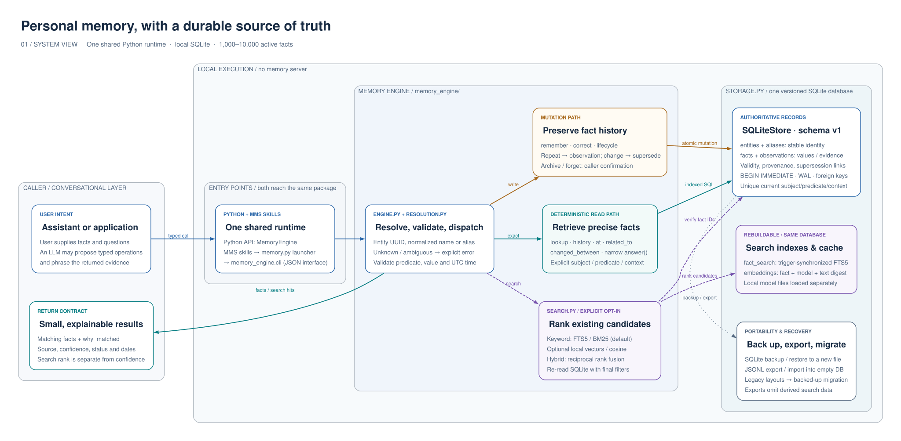

# Personal AI Memory Engine

A local-first, deterministic long-term memory layer for one assistant user. It stores structured facts rather than notes or chat transcripts, keeps history, and returns the smallest useful payload for an LLM to phrase.

## Quick start

```python
from memory_engine import MemoryEngine

memory = MemoryEngine("memory.db")
tommy = memory.create_entity("Tommy", "pet", aliases=["my dog"])
memory.remember(subject=tommy, predicate="eats", value="Hill's Science Diet")
memory.answer("What food does Tommy eat?")
# [RetrievedFact(... value="Hill's Science Diet" ...)]
```

Run the test suite with `python -m unittest discover -s tests -v` and benchmarks with `python benchmarks/benchmark.py`.

For lifecycle changes, use `correct()` to preserve an old fact as history, `archive()` to hide a fact while retaining it, and `forget()` only after explicit user confirmation to permanently remove one fact and its observations.

See [docs/architecture.md](docs/architecture.md) for the architecture, trade-offs, data model, lifecycle, and complexity analysis. The governing decision, implementation map, and future-agent handoff are in [ADR 0001](docs/adr/0001-local-deterministic-memory.md).

## Architecture preview

The diagrams preview a shared Python runtime for the API and MMS skills, with SQLite as the source of truth and optional local search. This branch currently ships the original split runtime.

[Architecture walkthrough and request flows](docs/architecture-diagrams.md)

[](docs/architecture-diagrams.md)
