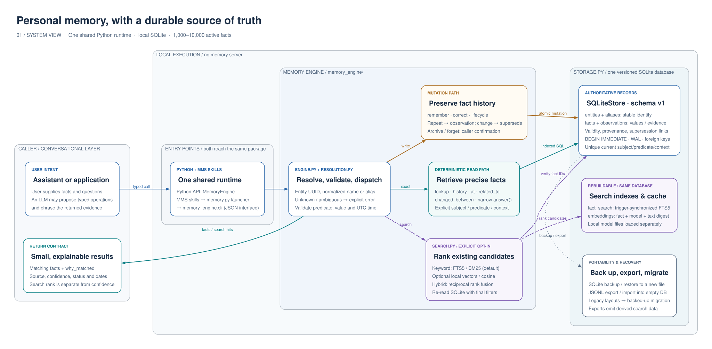
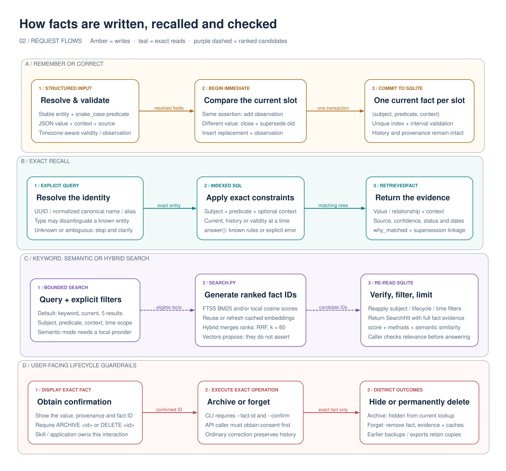

# Architecture, explained

These diagrams preview the shared Python runtime, including versioned SQLite storage and optional local search. The default branch currently ships the original split runtime. See the [published implementation architecture](architecture.md). The diagrams were authored with [mingrammer/diagrams](https://github.com/mingrammer/diagrams).

## System view

[Open SVG](assets/architecture-system.svg) · [Download PNG](assets/architecture-system.png) · [Editable Python source](diagrams/architecture.py)

Read the diagram from left to right. Boxes group responsibilities in one local application; they are not separate services or deployment units. The system stores small structured facts for one user, with an intended scale of roughly 1,000–10,000 active facts.

1. **The caller expresses intent.** An assistant may turn a user statement into explicit fields, or an application may call the Python API directly. An LLM may phrase the final answer. The engine does not automatically capture conversations, and it does not delegate entity identity or fact lifecycle decisions to an LLM.
2. **Both entry points reach one package.** The MMS skills execute `skills/mms-memory-engine/scripts/memory.py`, a compatibility launcher for `memory_engine.cli`. The CLI and direct Python callers use the same `MemoryEngine`, storage code and versioned database schema. Installing a skill folder alone is insufficient: the shared package must also be available.
3. **Identity and fields are checked before execution.** `EntityResolver` matches stable IDs, normalized canonical names and aliases. Normalization uses Unicode NFKC, case folding and collapsed whitespace. A known type can disambiguate; an unknown or ambiguous entity produces an error. Writes validate the predicate, JSON value, confidence and timezone-aware dates.
4. **Execution follows an explicit path.** Amber represents mutations; teal represents deterministic reads; dashed purple represents search candidates. Exact queries use indexed SQL. Keyword and optional semantic search rank existing facts and then re-read SQLite with the final filters. The arrows summarize calls and data dependencies; returned rows travel back through the engine to the caller.
5. **SQLite is the source of truth.** `SQLiteStore` manages schema version 1, transactions, indexes and recovery. Authoritative records contain identity, values, relationships, evidence and history. FTS5 documents and embedding vectors are derived data in the same database. The embedding model's files live separately on local disk.

## Request flows

[Open SVG](assets/architecture-flows.svg) · [Download PNG](assets/architecture-flows.png)

### A. Remember or correct: preserve the timeline

A fact occupies a logical **`(subject, predicate, context)` slot**. For example, `Me / employed_by / default` can hold Company A and later Company B without losing the earlier assertion.

| Input | Effect inside the transaction | Result |
|---|---|---|
| First assertion: Company A | Insert a current fact and its observation | One current fact |
| Repeat Company A | Add another observation to the existing fact | More evidence, same fact ID |
| Correct to Company B | Close A's validity interval, mark A superseded, insert B with a link to A | B is current; A remains in history |

`BEGIN IMMEDIATE` serializes writers. A partial unique index enforces at most one current fact per slot. Interval checks reject invalid or backdated replacements instead of silently rewriting the timeline. The default observation time is now; validity time can be supplied separately.

### B. Exact recall: retrieve a precise answer

When the subject and predicate are known, use `lookup()`. Add a context or point in time when needed. `history()` returns the timeline; `related_to()` finds current relationships pointing to an entity. `changed_between()` returns assertions first observed within the range, rather than a complete audit of all mutations.

The small `answer()` rule planner maps recognized wording to these exact operations. Unrecognized wording produces an explicit error. Every `RetrievedFact` includes the value or relationship, source, confidence, observation and validity timestamps, lifecycle status, context and `why_matched`.

### C. Search: discover candidates, then verify

`search()` is a separate, explicit operation when the caller does not know the stored wording. Keyword mode uses FTS5 and BM25. Optional semantic mode loads a predownloaded local Sentence Transformers model, embeds text and compares vectors using cosine similarity. Hybrid mode combines lexical and semantic ranks with reciprocal rank fusion (`k = 60`). Model files are acquired separately; querying does not download weights or send facts to an external model service.

Before returning a result, search re-reads candidate fact IDs from SQLite and reapplies the subject, predicate, context, lifecycle and time filters. This also protects against facts being archived or deleted during slower model work. Search defaults to five current facts and accepts at most 100 results. An explicit ambiguous subject still fails; ranking cannot choose its identity.

Each `SearchHit` wraps the full authoritative fact plus a rank score, match methods and optional semantic similarity. **Rank and similarity are not fact confidence or proof that a hit answers the question.** The caller still checks relevance. Cached semantic retrieval scans eligible vectors in Python, so its cost grows with the number of eligible facts and embedding dimensions.

### D. Archive or forget: distinct user decisions

The skill or application first shows the exact fact and obtains `ARCHIVE <fact-id>` or `DELETE <fact-id>`. The CLI additionally requires `--fact-id` and the matching `--confirm` marker. Direct Python callers must obtain that consent themselves; the API does not implement a conversational confirmation screen.

Archive hides the fact from normal current retrieval while retaining history. Forget permanently removes that fact and its observations, clears supersession references to it, removes its FTS entry and cascade-deletes its embeddings. Earlier backups and exports still contain their copies.

## Data and recovery boundaries

| Data | Role | Recovery behavior |
|---|---|---|
| `entities`, `aliases` | Stable UUIDs, names, types and deterministic name matching | Included in backup and JSONL export |
| `facts`, `observations` | Values, object-entity links, evidence, dates, confidence and lifecycle history | Included in backup and JSONL export |
| `fact_search`, `embeddings` | Rebuildable keyword index and model-specific vector cache | Included in backup; omitted from JSONL export |
| Local model directory | Optional semantic encoder, outside the database | Provisioned separately |

Backup uses SQLite's live backup API; restore requires a new destination. JSONL import requires an empty database and validates the records transactionally. Recognized legacy CLI and reference schemas receive a pre-migration backup before transactional conversion. Unknown newer schemas and invalid legacy records are rejected.

The core exact/keyword runtime uses the Python standard library and requires SQLite with FTS5 and JSON support. Semantic dependencies and diagram-authoring dependencies are optional and separate. See [diagram regeneration](diagrams/README.md) to edit or render these views.
